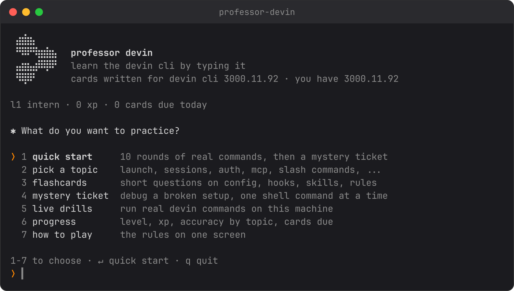
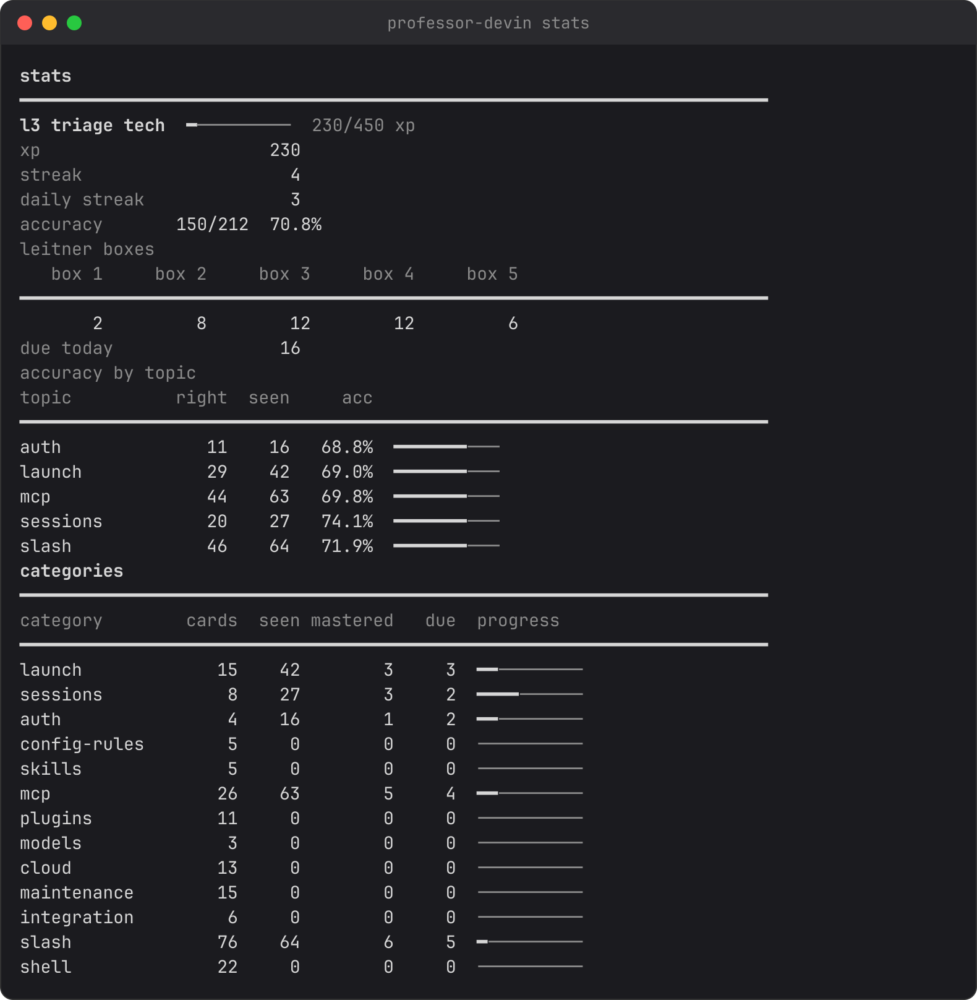

# Professor Devin

Learn the Devin CLI by typing it. Professor Devin is a terminal game that
asks you to write real `devin` commands, checks them against the CLI's own
`--help` output, and brings back the ones you miss until they stick.

## Install (about a minute)

You need Python 3 (macOS and Linux have it; on macOS, `xcode-select --install` adds it if missing).

    git clone https://github.com/adames/Devin-CLI-trainer.git
    cd Devin-CLI-trainer
    bash install.sh
    professor-devin

`install.sh` links `professor-devin` into `~/.local/bin` and offers to add
that folder to your PATH. Prefer not to install? `./professor-devin` runs it
from the repo.

New to the terminal? Every screen tells you what to type. Pick an option with
a number, press Enter, and type commands exactly as you would in a real shell.

## What you practice

| Mode | What happens | Start it |
| - | - | - |
| Command rounds | A task appears; you type the `devin` command that does it. Multiple choice first, then fill-in-the-blank, then full recall. | menu 1 or 2 · `professor-devin train [topic]` |
| Mystery tickets | A broken setup described like a support ticket. You run shell commands in a simulated customer machine, find the evidence, name the root cause and the fix. | menu 4 · `professor-devin play --mode combo` |
| Flashcards | Short questions on config, hooks, skills, rules, and the shell. | menu 3 · `professor-devin play --mode flash` |
| Live drills | Real `devin` commands on your machine (version, doctor, rules, MCP). Credit-using drills stay off unless you opt in. | menu 5 · `professor-devin play --mode drill` |

Command rounds and tickets are simulated; nothing you type in them runs for real.

## How it teaches

- **Real answers.** Every `devin` command card is validated against the captured `devin <cmd> --help` text in `dojo/content/help/` (CLI 3000.11.92), so a wrong flag gets a precise correction, not just "wrong".
- **Spaced repetition.** Each card sits in one of five boxes. Get it right and it moves up and comes back later (1, 3, 7, 21 days); miss it and it returns to box 1.
- **Harder as you learn.** Box 1 cards are multiple choice, box 2 fill-in, box 3+ full recall. Fix cards show a broken command and its error.
- **XP and levels.** Streaks multiply XP up to 3x. Levels run Intern, Log Reader, Triage Tech, Tracer, Config Whisperer, Root-Causer, Staff RCA.

## Topics

209 command cards in 13 topics: launch, sessions, auth, config-rules, skills, mcp, plugins, models, cloud, maintenance, integration, slash (slash commands inside the REPL), shell (support one-liners). Plus 101 flashcards, 12 mystery tickets, and 14 live drills.

## From the command line

    professor-devin                     home menu
    professor-devin train mcp           10 rounds on one topic, then a ticket
    professor-devin play --mode flash   flashcards only
    professor-devin stats               level, accuracy by topic, cards due
    professor-devin help train          flags for any command

Progress lives in `~/.professor-devin/` (`PROFESSOR_HOME` overrides it). `professor-devin reset` clears it.

## Study material

- [GUIDE.md](GUIDE.md): the written course the game is built from — a four-week plan, the CLI's file layout, labs, break-it drills, and a support triage checklist. The shell commands in section 4 are the answers to the `shell` cards and the mystery tickets.
- [cards.tsv](cards.tsv) + `./drill.sh [N] [regex]`: the same flashcards as a plain bash drill.
- [docs/README.md](docs/README.md): offline snapshots of the docs.devin.ai CLI pages the content cites.

## Requirements and limits

- macOS or Linux, Python 3.8+, no dependencies. Shell answers are written for macOS (BSD userland); on Linux the equivalents are `cat /proc/<pid>/environ` for `ps eww`, `strace -f -e trace=file` for `fs_usage`, and `ss -tpn` for `lsof -iTCP`.
- Content is pinned to Devin CLI 3000.11.92; the menu shows your installed version next to it. Newer CLIs add commands the cards don't cover yet.

## Contributing

- [dojo/README.md](dojo/README.md): the player's manual (every screen, key, and score).
- [dojo/CONTRIBUTING.md](dojo/CONTRIBUTING.md): where facts come from and how to add cards.
- [dojo/SPEC.md](dojo/SPEC.md) and [dojo/DESIGN.md](dojo/DESIGN.md): exact behaviour and terminal styling.
- Tests: `cd dojo && python3 -m unittest discover -s tests -v`. Screenshots: `python3 tools/screenshots.py`.
