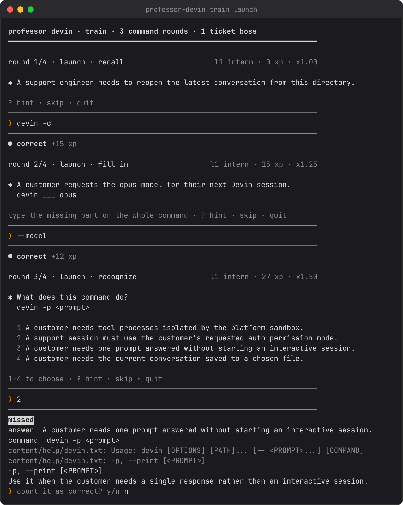
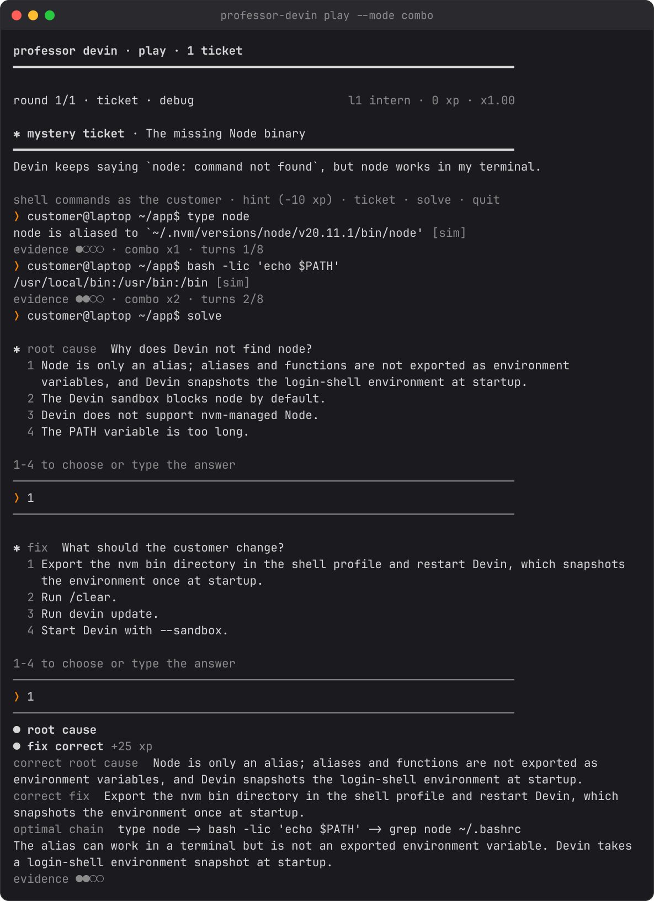

# Professor Devin: player's manual

Every screen, key, and score in the game. Run `professor-devin` (or
`./professor-devin` from the repo) to start.

## First run and profiles

The first time the menu opens you are asked how well you know the Devin CLI:

- **new to it** (default) — the beginner profile: command cards start as
  multiple choice, and your first rounds show one-line `tip` hints.
- **already using it** — the veteran profile: every write card asks for the
  full command from the start, and no tips are shown.

Profiles change only the question form and the tips — XP, levels, and spaced
repetition work the same either way. Change it later with
`professor-devin setup`. Subcommands never show the wizard: `train`, `play`,
`stats` and friends run straight through. Tips belong to the profile, not the
entry point — a beginner who runs `professor-devin train` directly still sees
them in the first rounds.

## The home menu

In a terminal, `professor-devin` opens the home menu; `professor-devin menu`
opens it anywhere. Each choice prints the CLI command it stands for under
`next time:` in the session header.

| Key | Activity | Same thing from the CLI |
| - | - | - |
| 1 (or just ↵) | Quick start: 10 command rounds, then a mystery ticket | `professor-devin train` |
| 2 | Pick a topic: the same session on one category | `professor-devin train <topic>` |
| 3 | Flashcards | `professor-devin play --mode flash` |
| 4 | Mystery ticket | `professor-devin play --mode combo` |
| 5 | Live drills | `professor-devin play --mode drill` |
| 6 | Progress: level, accuracy by topic, cards due | `professor-devin stats` + `categories` |
| 7 | How to play: the rules on one screen | — |
| q | Quit | — |

## A round, line by line

- `round 3/11 · launch · recall` counts the rounds, names the topic and the
  form; the right side shows your level, XP, and streak multiplier.
- `✱` marks the task to do.
- The muted footer (`? hint · skip · quit` or `1-4 to choose · ...`) lists
  the keys that work right now.
- You type on the `❭ ` line between the hairlines.
- `● correct +15 xp` is the outcome. A miss shows ` missed `, then
  `answer`/`command`, the `devin --help` lines the answer came from, the
  explanation, and `❭ count it as correct? y/n` — answer `y` if you were
  right in spirit.
- `?` shows the hint once (it halves that round's XP), `skip` reveals the
  answer and moves on, `quit` stops and saves. Ctrl-C saves too.

## The four forms

- **recognize** — you see a command and pick what it does (1-4, or a-d, or
  type the task text).
- **fill in** — a command with one piece blanked out; type the missing part,
  or the whole command.
- **recall** — write the whole command from the task.
- **fix** — a broken command and its real error; type the corrected command.

## Mystery tickets

A customer's broken setup, one shell command at a time — simulated: nothing
runs for real. Type shell commands at the `❭ customer@… $` prompt. New
evidence commands fill the evidence dots (`●○○○`) and build the combo
multiplier (up to x3). `ticket` reprints the message, `hint` shows the next
optimal command and costs 10 XP, `solve` moves to the diagnosis questions,
`quit` ends the session. When the turns run out you have to solve. Name the
root cause and the fix from the numbered choices.

## Live drills

Drills run real `devin` commands on your machine inside
`$PROFESSOR_HOME/arena/<drill-id>/`. A drill is skipped when your platform or
a required program is missing, when `devin auth status` reports
`Not logged in`, when it may use credits without `--allow-credits`, or under
`--no-live`. Inside a drill, `!<command>` runs a shell command in the arena
as often as you like; `give up` shows the explanation.

## Spaced repetition

Every item lives in one of five boxes:

| Box after a correct answer | Wait before it is due |
|---:|---:|
| 2 | 1 day |
| 3 | 3 days |
| 4 | 7 days |
| 5 | 21 days |

A miss resets the card to box 1, due now. Command-card boxes choose the form:
box 1 recognize, box 2 fill in, box 3+ recall.

## XP

- Command rounds: recognize 5, fill in 10, recall or fix 15. A hint or a
  self-grade halves the round.
- Flashcards: 10, or 5 with a hint or self-grade.
- Live drills: 25 plus a speed bonus of up to 15.
- Tickets: 50 + 10 per evidence command + 5 per unused turn, times the best
  combo; a wrong root cause costs 20, a correct fix adds 25.

The streak multiplier is `1 + 0.25 × streak`, capped at x3. Your level is
`floor(sqrt(xp / 50)) + 1`: Intern, Log Reader, Triage Tech, Tracer, Config
Whisperer, Root-Causer, Staff RCA.

## Command reference

    professor-devin [menu]                          home menu
    professor-devin train [CATEGORY ...] [--rounds N] [--tier 1|2|3] [--seed N]
    professor-devin play [--mode flash|drill|combo] [--topic REGEX]
                         [--rounds N] [--seed N] [--no-live] [--allow-credits]
    professor-devin stats
    professor-devin categories
    professor-devin list [--type flash|drill|combo|command]
    professor-devin reset [--yes]
    professor-devin setup                          beginner or veteran profile
    professor-devin help [COMMAND]
    professor-devin -h | --help    -V | --version

`--rounds` defaults to 10, `--tier` to 3, `--seed` repeats a shuffle.
`--no-live` skips drills; `--allow-credits` permits credit-using ones.
`reset` asks for confirmation unless `--yes`.

## Saved progress

State lives in `$PROFESSOR_HOME/state.json` — `PROFESSOR_HOME` first, then
`DOJO_HOME`, then `~/.professor-devin/`. Live-drill arenas sit under
`arena/` in the same folder. `professor-devin reset` erases it.

## Troubleshooting

- `professor-devin: command not found` — easiest: re-run the installer,
  `curl -fsSL https://raw.githubusercontent.com/adames/Devin-CLI-trainer/main/get.sh | bash`,
  or add `export PATH="$HOME/.local/bin:$PATH"` to your shell rc, or run
  `./professor-devin` from the repo.
- No colors — colors need a terminal with `NO_COLOR` unset; force them in a
  pipe with `FORCE_COLOR=1`.
- Glyphs look wrong — the game needs a UTF-8 terminal; it falls back to
  ASCII automatically when the encoding isn't UTF-8.
- `devin not installed` in the banner — the game still works; only live
  drills need the CLI.

## Development

- Tests: `cd dojo && python3 -m unittest discover -s tests -v`
  (`flake8 --max-line-length 120 dojo.py tests/` if you have flake8).
- Screenshots in `assets/`: `python3 tools/screenshots.py` (regenerate after
  UI changes).
- Shell cards quote `../GUIDE.md` lines verbatim and cite them by line
  number. After editing the guide, run `python3 tools/relink_guide_sources.py`
  to re-point the citations (a test checks they match).
